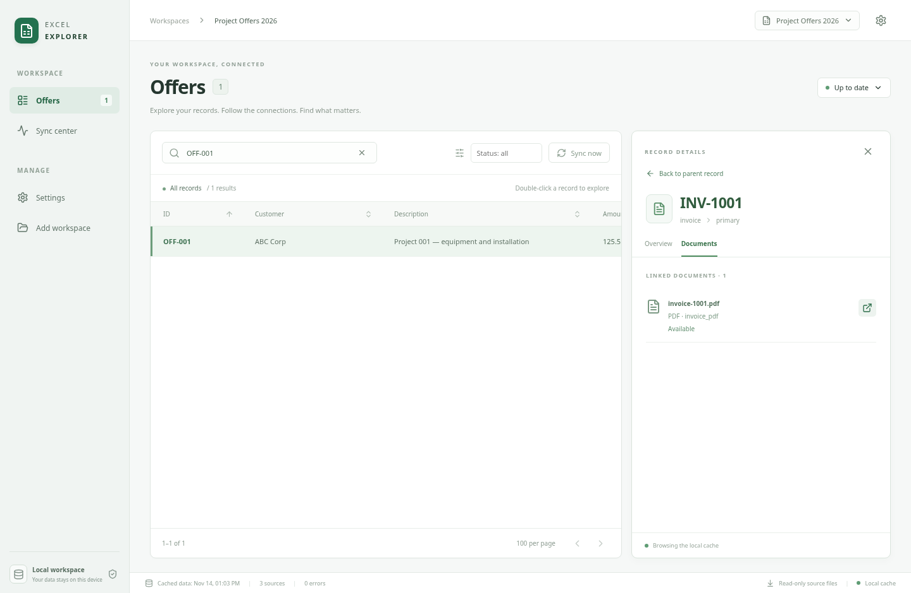
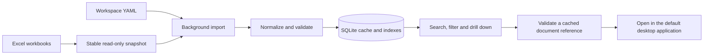
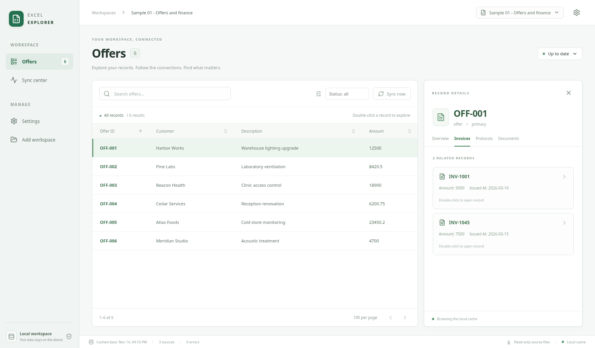
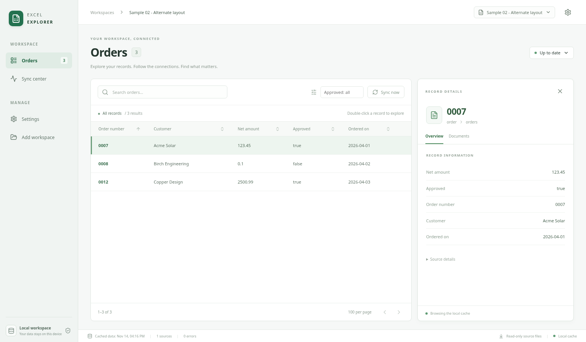
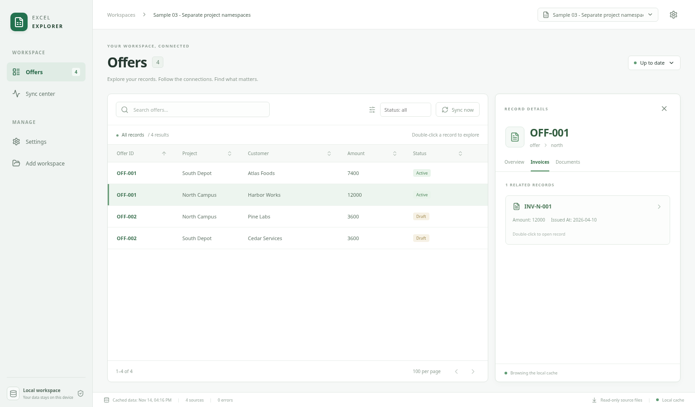
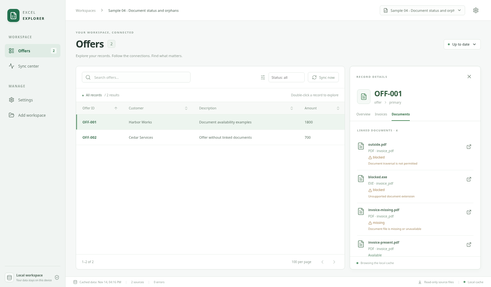
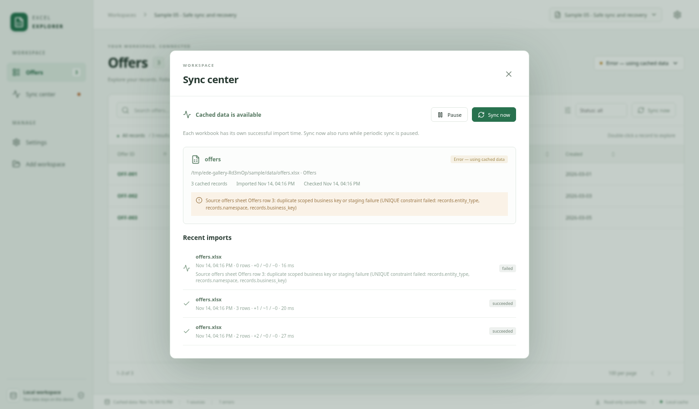

# Excel Data Explorer
A working local-first Windows desktop application for exploring mapped Excel workbooks as indexed records, relationships and document links. Built with Tauri 2, Rust, SQLite/FTS5, React and TypeScript. No Excel installation, Python backend, application server or cloud service is required. Workbooks are read-only ingestion sources; browsing always uses the persistent SQLite cache.



## Install and run
Prerequisites: Node 22/24 LTS, current Rust stable (1.100 or newer), Python 3 for regenerating fixtures. Windows 11 x64 development also needs Visual Studio 2022 C++ Build Tools/Windows SDK and WebView2 Evergreen. See [Windows release instructions](docs/WINDOWS_RELEASE.md).

```sh
npm ci
npm run demo
npm run desktop
```

The desktop opens the included **Project Offers 2026** workspace on first run and imports its generated workbooks in background. An alternate workspace demonstrates different sheet/column names and leading-zero keys. `npm run demo` deterministically regenerates the repository fixtures using Python's standard library; generated XLSX files and valid sample PDFs are already included. The installed app copies its demo to the per-user data folder and does not overwrite existing demo files.

Double-click an offer (or select it with arrow keys and press Enter). OFF-001 has invoices INV-1001 / INV-1045 and protocol PR-022. Double-click related records to drill down; Documents includes their PDF links. Missing PDFs remain visible with status. Search uses literal prefix tokens; filter inputs match exact configured values (e.g. Active). Columns resize and sort. Tables page 100 records and virtualize visible rows. Escape/back navigates out of details.

Add a YAML file through **Add workspace**, select it from the workspace picker and Sync now. Mappings, entities, namespaces, main columns, filters and relation tabs come from configuration. See [the complete configuration contract](docs/CONFIGURATION.md) and [demo YAML](workspaces/demo-workspace.yaml).

## How it works

A YAML configuration tells Explorer which workbook sheets to read, how Excel headers map to typed fields, which string fields identify records, and how records relate. The background worker waits for a stable file, copies a read-only snapshot and parses the configured worksheets. It validates the rows and builds a new indexed generation in local SQLite. A whole workbook activates together; a malformed key, duplicate ID, unavailable file or failed transaction leaves the previous valid cache in place.



Search, filters, tables and related-record tabs query SQLite; they do not reread Excel. That is why the last valid data remains browsable while a workbook is disconnected or importing. Documents stay in their folders: the cache stores references and availability, and opening rechecks the allowed root/extension. Sources can have different successful import times, shown in Sync center. There is no Excel writeback or formula/macro execution.

## Sample gallery

The [demo folder](demo/README.md) contains **five self-contained examples**, **11 XLSX files**, **5 YAML profiles**, **8 synthetic PDFs**, expected-result manifests, and a screenshot for each example. Files are already generated; no private data is needed. Copy an entire example folder if desired, then use **Add workspace → its `workspace.yaml` → select workspace → Sync now**. All input/document paths are relative to that YAML file.

| Sample | Configuration | Workbooks | What to try |
|---|---|---|---|
| [01 — Offers and finance](demo/01-offers-and-finance/README.md) | [workspace.yaml](demo/01-offers-and-finance/workspace.yaml) | [offers.xlsx](demo/01-offers-and-finance/data/offers.xlsx), [finance.xlsx](demo/01-offers-and-finance/data/finance.xlsx) | 6 offers, 8 invoices, 3 protocols; open OFF-001 and its PDFs |
| [02 — Alternate layout](demo/02-alternate-layout/README.md) | [workspace.yaml](demo/02-alternate-layout/workspace.yaml) | [orders.xlsx](demo/02-alternate-layout/data/orders.xlsx) | Map different/reordered headers; preserve 0007; normalize decimal, boolean and date values |
| [03 — Separate namespaces](demo/03-namespaces/README.md) | [workspace.yaml](demo/03-namespaces/workspace.yaml) | [north.xlsx](demo/03-namespaces/data/north.xlsx), [south.xlsx](demo/03-namespaces/data/south.xlsx) | Keep repeated OFF-001 IDs distinct and drill into each project's invoices |
| [04 — Documents and orphans](demo/04-documents-and-orphans/README.md) | [workspace.yaml](demo/04-documents-and-orphans/workspace.yaml) | [offers.xlsx](demo/04-documents-and-orphans/data/offers.xlsx), [invoices.xlsx](demo/04-documents-and-orphans/data/invoices.xlsx) | See an available PDF, a missing file, two blocked references and an orphan warning |
| [05 — Sync and recovery](demo/05-sync-recovery/README.md) | [workspace.yaml](demo/05-sync-recovery/workspace.yaml) | [active input](demo/05-sync-recovery/data/offers.xlsx), [baseline](demo/05-sync-recovery/scenarios/baseline.xlsx), [updated](demo/05-sync-recovery/scenarios/updated.xlsx), [invalid](demo/05-sync-recovery/scenarios/invalid.xlsx) | Import 2 → 3 offers, reject a duplicate-key update without losing the 3-record cache, then recover |

### 01 — Offers and finance

Double-click **OFF-001 → Invoices** to find **INV-1001 / INV-1045**; Protocols contains **PR-022**. The Documents tab unifies their three available PDFs. [Full walkthrough](demo/01-offers-and-finance/README.md).



### 02 — Alternate Excel layout

The `Sales Export` sheet uses OrderNumber / CustomerName / TotalNet / SignedOff / OrderedOn, mapped to generic fields without changing Rust or React. Open **0007** to inspect exact `123.45`, boolean `true` and a date-only value. [Field mapping and walkthrough](demo/02-alternate-layout/README.md).



### 03 — Same IDs, different projects

North Campus and South Depot both have **OFF-001**. North's record links only to **INV-N-001**, and south's only to **INV-S-001**. Namespace is part of identity and joins. [Namespace walkthrough](demo/03-namespaces/README.md).



### 04 — Document status and unmatched relationships

**OFF-001 → Documents** shows one available PDF, one missing PDF and two blocked references (traversal and executable extension). No executable is supplied. **INV-ORPHAN → OFF-404** remains cached and raises a warning rather than inventing a parent. [Expected statuses and walkthrough](demo/04-documents-and-orphans/README.md).



### 05 — Failed sync and recovery

Start with two offers; run `python demo/apply_scenario.py updated` from the repository root and Sync now to reach three. Apply `invalid` and Sync again: the error appears while the three valid cached offers remain. `offline` / `online` simulate disconnection; `baseline` fixes/restores the valid two-offer input. The helper explicitly changes only synthetic demo input, while Explorer remains read-only. [Complete step-by-step exercise](demo/05-sync-recovery/README.md).



### Regenerate sample data and images

```sh
npm run demo:samples       # Regenerate just the five curated examples
npm run demo               # Regenerate both original fixtures and the new gallery
npm run core:build
npx playwright install chromium
npm run demo:images        # Capture all five preview.png images using the real backend
```

Regeneration resets synthetic source files and the recovery exercise; authored YAML/configuration guides are left intact. The five images are actual React UI screenshots backed by Rust/SQLite through a test-only IPC bridge; Windows native chrome/events are stubbed for capture. The [demo guide](demo/README.md) explains every file, expected result and regeneration command. The original larger 120-offer fixture in `fixtures/demo/` remains available as the first-run application demo.

## Desktop defaults
- **Windows sign-in:** autostart enabled, `--background` invocation stays hidden and synchronizes in background.
- **Close window:** hides to tray and keeps the process/cache ready. Tray Open restores it; tray Exit cancels work and terminates.
- **Manual/second launch:** shows/restores the same single instance.
- **Interactive data:** reads local SQLite, including when workbooks are disconnected. Failed imports preserve the previous valid workbook generation and disclose stale status.

Autostart and close-to-tray are configurable in Settings. The tray also offers Sync now, Pause / Resume sync, Settings and Sync status. Sync now explicitly overrides pause for that job without changing the pause preference. Workspace, selected record/detail visibility, search/filter/sort/page/column widths and window geometry persist. Each workbook has an independent successful import time; the UI never implies a global cross-file transaction.

## Tests and diagnostics
```sh
npm run test:core
python -m unittest discover -s demo -p "test_*.py"
npm run lint:core
npm test
npm run build
npm run format:check
npm run core:build
npx playwright install chromium
npm run test:e2e
```

For an installed compatible Chromium, set `CHROMIUM_PATH` (e.g. `/usr/bin/chromium`) instead of installing Playwright's browser. In this managed workspace, scripts automatically use the optional `.tooling` Rust installation. On normal machines they use Rust from PATH.

Core-only demo, without WebView/system GUI libraries:
```sh
node scripts/run.mjs cargo run --manifest-path src-tauri/Cargo.toml --no-default-features -- import ./demo-cache.sqlite ./workspaces/demo-workspace.yaml
node scripts/run.mjs cargo run --manifest-path src-tauri/Cargo.toml --no-default-features -- rpc ./demo-cache.sqlite
```

The `rpc` diagnostic mode accepts newline-delimited typed JSON on stdin, e.g. `{"command":"query_records","workspace_id":"demo","entity_type":"offer","options":{"search":"OFF-001","limit":100}}`. It uses the same engine, not an HTTP server. A plain `npm run dev` browser tab has no native cache connection; use the desktop command for the full app. The Playwright test bridge exists only in tests.

[Verification report](docs/TEST_REPORT.md): 34 Rust, 2 Python demo-helper tests, 3 frontend and 9 real-core browser tests pass on Linux; Windows-target native API/type checking passed. Windows GUI/installer/sign-in acceptance still requires execution on Windows. [Measured performance](docs/PERFORMANCE.md): 70,001-record release benchmark with real latency, import throughput and memory results; full target-scale and Windows metrics remain unmeasured.

```sh
python benchmarks/run.py --offers 10000 --output /local/ssd/ede-benchmark
# Full specification-scale fixture; use a local volume with ample free space:
python benchmarks/run.py --offers 100000 --output /local/ssd/ede-benchmark-large
```

## Build the Windows installer
Run on a Windows development machine:
```sh
npm ci
npm run demo
npm run desktop:build
```

The per-user NSIS installer is created in `src-tauri/target/release/bundle/nsis/`. Signing and Windows test scripts are described in [WINDOWS_RELEASE.md](docs/WINDOWS_RELEASE.md). The supplied CI workflow runs core/UI checks and Windows native checks; manual dispatch also builds an unsigned installer artifact. It has not been run remotely from this workspace.

## Milestones
Formal implementation order was M0 → M1 → M2 → M3 → M4 → M5 → M6, with integration refinements as the core became available. Runnable entry points and verification were maintained at each stage.

| Milestone | Implemented and verified | Remaining platform acceptance |
|---|---|---|
| M0 — tooling/demo | Tauri/React/Rust project, locked dependencies, deterministic XLSX/PDF generator, portable profiles, basic builds/tests | None for cross-platform tooling |
| M1 — lifecycle | Hidden/manual launch policy tests; native single-instance, tray, autostart, preference and geometry persistence code | Actual Windows sign-in, X/tray/Exit/reopen and UI-state lifecycle |
| M2 — ingestion | Typed YAML validation, alternative layouts, cells/types, decimal/date semantics, formulas, row diagnostics and tests | Representative private workbooks when available |
| M3 — cache/query | WAL/migration, stable scoped identities, typed indexes, FTS, relations, documents, history, atomic activation and offline tests | None for exercised core behavior |
| M4 — UI | Virtual table, mapped search/filter/sort, keyboard/double-click drill-down, docs, settings and saved state; browser→Rust tests | Native Windows default PDF launching and DPI checks |
| M5 — synchronization | Serial/coalescing worker, notifications + scans, stable copies, staging/rollback, failure states, pause/manual controls, recovery/concurrent reads | Windows locks, real SMB, sleep/resume/reconnect field validation |
| M6 — hardening/release | Benchmarks, failure/plan regression tests, diagnostics, Windows installer configuration, CI and release/operations docs | Full 700k benchmark, Windows GUI/installer/signing, CPU/FPS/launch targets |

## Troubleshooting and limits
Sync center shows per-source paths, sheets, checked/imported times, row counts and diagnostics; click a recent import to see row/field errors. Offline/locked/malformed sources keep their committed records. Correct the source/config and Sync now. Configuration errors keep the persisted last-good profile. Use Settings → Open logs folder for sanitized stage/timing logs.

The database lives at `%LOCALAPPDATA%/ExcelDataExplorer/cache.sqlite`, with logs and the writable demo nearby. Never place the cache on a network share. The diagnostic CLI lets you choose a local cache path explicitly. Keep the cache if you need offline browsing; it is not a substitute for source backups. The application does not encrypt SQLite; Windows device encryption/BitLocker is appropriate for confidential data.

Calamine materializes worksheet ranges, so extreme workbooks still need a RAM benchmark. Large activation/relationship rebuilds may be long transactions; WAL protects readers. A blocked SMB OS call can delay cancellation/Exit. Metadata checks can miss content rewritten with identical size and timestamp; manual Sync now forces reimport. New source directories are covered by periodic checks even if they were added after watcher initialization. Document listings cap at 1,000 links with an explicit label; availability checks run in bounded background batches. Decimal numeric projections approximate sorting while canonical text preserves values. Sorting is one column at a time. No editing/writeback, formula calculation, macro execution, OCR or document-content search is implemented.

Next release checks: execute the Windows acceptance script/checklist, import/benchmark the full synthetic fixture on Windows, then test representative company workbooks and a real UNC share before signing a production installer.

Further details: [architecture](docs/ARCHITECTURE.md), [data model](docs/DATA_MODEL.md), [synchronization](docs/SYNCHRONIZATION.md), [decisions](docs/DECISIONS.md), [source specification](EXCEL_DATA_EXPLORER_CODEX_SPEC.md).
