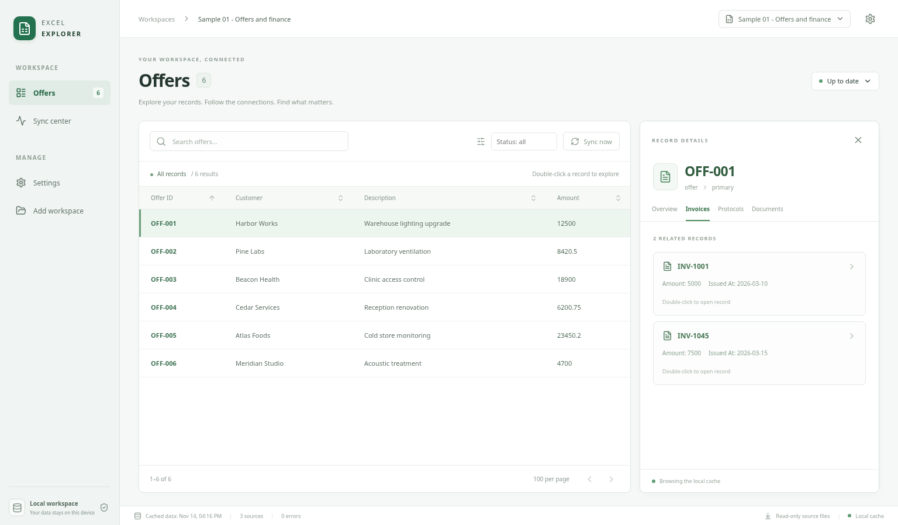

# 01 — Offers, invoices and protocols

Open [workspace.yaml](workspace.yaml) through **Add workspace**, select **Sample 01 - Offers and finance**, then click **Sync now**.

Inputs: [offers.xlsx](data/offers.xlsx) contains the `Offers` worksheet; [finance.xlsx](data/finance.xlsx) contains `Invoices` and `Protocols`. The configuration joins `offer.id = invoice.offer_id` / `protocol.offer_id` in namespace `primary`. Both finance sheets publish from one snapshot.

Expect **6 offers, 8 invoices and 3 protocols**, with no orphan warnings. Double-click **OFF-001**, then try Invoices (INV-1001 / INV-1045), Protocols (PR-022) and Documents (three available PDFs). Double-click an invoice to inspect its fields, then use Open document. Search `Harbor` or filter Status by `Active`.

[Expected results](expected-results.json) · [All examples](../README.md)
