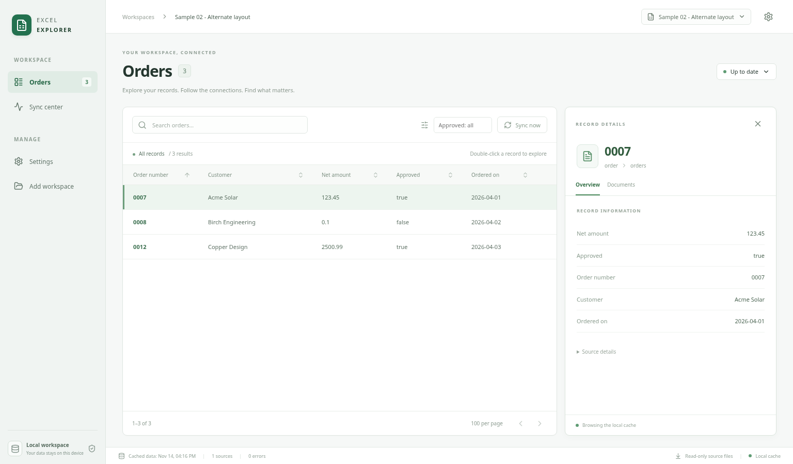

# 02 — Alternate layout and typed fields

Open [workspace.yaml](workspace.yaml), select **Sample 02 - Alternate layout**, and Sync now. [orders.xlsx](data/orders.xlsx) uses worksheet `Sales Export` and intentionally different/reordered headers.

| Excel header | Application field | Type |
|---|---|---|
| OrderNumber | code | Required string key |
| CustomerName | customer | Searchable string |
| TotalNet | amount | Exact decimal string |
| SignedOff | approved | Boolean |
| OrderedOn | ordered_at | Date-only ISO value |

Expect **3 orders**: **0007**, **0008**, **0012**. Their leading zeros remain intact. Open 0007: its amount is `123.45` from source text `123.4500`, approval is `true`, and ordered date is `2026-04-01`. Approved filters accept exact `true` / `false`; this example has no document references.

[Expected results](expected-results.json) · [All examples](../README.md)
