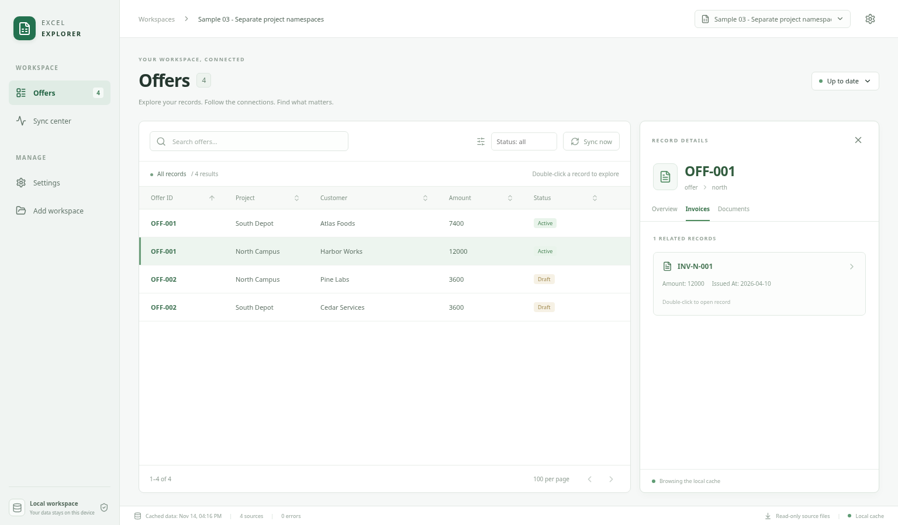

# 03 — Repeated IDs in independent namespaces

Open [workspace.yaml](workspace.yaml), select **Sample 03 - Separate project namespaces**, and Sync now.

[north.xlsx](data/north.xlsx) and [south.xlsx](data/south.xlsx) each contain `Offers` and `Invoices`. Both contain OFF-001 and OFF-002. North mappings share namespace `north`; south mappings share namespace `south`.

Expect **4 offers, 4 invoices and 4 available PDFs**. Open North Campus / OFF-001: Invoices shows only INV-N-001. Open South Depot / OFF-001: it shows only INV-S-001. The UI's Project column helps distinguish the repeated IDs, and the detail heading shows the namespace.

Internal identity includes workspace, entity, namespace and key; relationship joins require the same namespace. A north offer cannot accidentally inherit a south invoice just because their Excel IDs match.

[Expected results](expected-results.json) · [All examples](../README.md)
