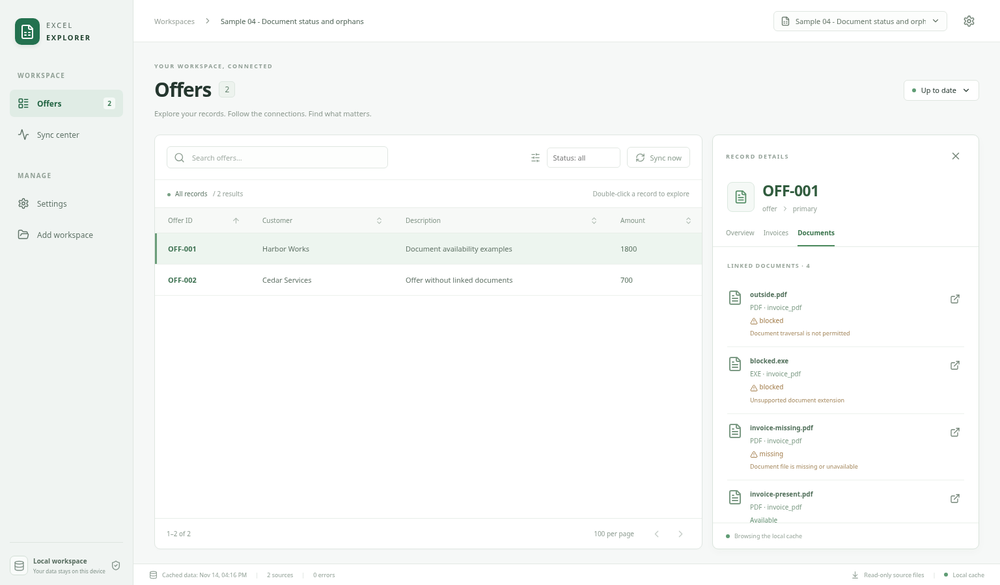

# 04 — Missing documents, rejected paths and orphan invoices

Open [workspace.yaml](workspace.yaml), select **Sample 04 - Document status and orphans**, and Sync now. Inputs are [offers.xlsx](data/offers.xlsx) and [invoices.xlsx](data/invoices.xlsx).

Expect **2 offers and 5 invoices**. Open **OFF-001 → Documents**:

| Reference | Expected result |
|---|---|
| invoice-present.pdf | Available; desktop opens the supplied synthetic PDF |
| invoice-missing.pdf | Missing; the invoice/link remains cached |
| ../outside.pdf | Blocked; traversal outside the configured root |
| blocked.exe | Blocked; unsupported executable extension |

No executable is supplied or executed. The blocked example is only a workbook string. Opening a missing or blocked reference produces a nonfatal error. Successful source freshness does not mean every external document is available.

**INV-ORPHAN** references absent **OFF-404**. It remains cached and produces one unmatched-relation warning in Sync center. No fake parent offer is created. The main Offers screen therefore does not show that invoice under OFF-001 or OFF-002.

[Expected results](expected-results.json) · [All examples](../README.md)
