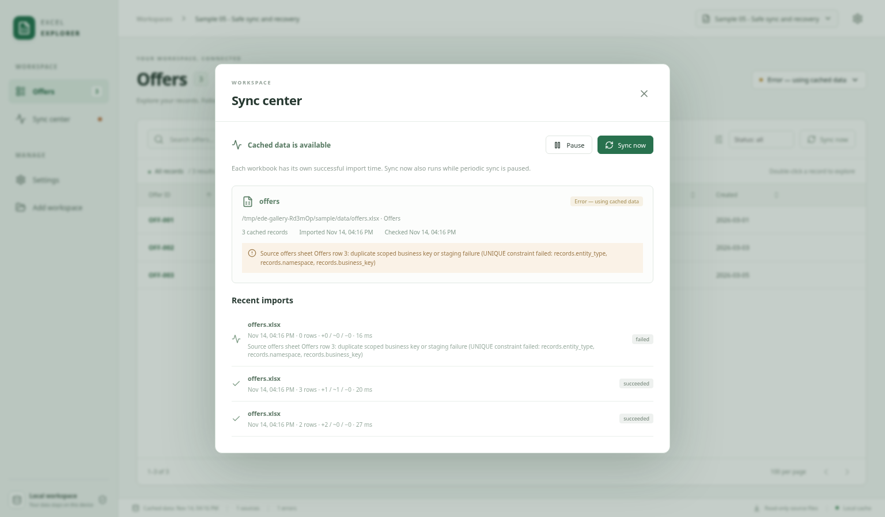

# 05 — Updates, rejected imports and offline recovery

Open [workspace.yaml](workspace.yaml), select **Sample 05 - Safe sync and recovery**, then Sync now. The configured input is always [data/offers.xlsx](data/offers.xlsx); the files under `scenarios/` are alternatives you explicitly apply to that path.

| Step | Input | Expected cache and status |
|---|---|---|
| Initial | [baseline.xlsx](scenarios/baseline.xlsx) | 2 offers; successful import |
| updated | [updated.xlsx](scenarios/updated.xlsx) | 3 offers; OFF-001 changes to 15000; OFF-003 is added |
| invalid | [invalid.xlsx](scenarios/invalid.xlsx) | Duplicate OFF-001; previous 3 offers and successful generation remain |
| offline | Active input temporarily renamed | Cached — source unavailable; keep browsing 3 offers |
| online | Same input restored | Still invalid until the workbook is fixed |
| baseline | Original valid input restored | Successful recovery; 2 offers |

From the **repository root**, run a command, then click **Sync now** after each step:

```sh
python demo/apply_scenario.py updated
python demo/apply_scenario.py invalid
python demo/apply_scenario.py offline
python demo/apply_scenario.py online
python demo/apply_scenario.py baseline
```

Open Sync center after the invalid step. The successful import time/generation does not advance on failure; the error identifies the duplicate row. The screenshot below was captured at this step, after the cache had already reached three offers. You can also keep the window open and let local file notifications/periodic checks import changes; manual Sync now makes the walkthrough predictable.

The helper changes only this synthetic sample; Explorer never writes to Excel. It uses atomic replacement and refuses to overwrite a saved offline workbook. Regenerate all sample data with `npm run demo:samples` if you want to reset the exercise.



[Expected results](expected-results.json) · [All examples](../README.md)
