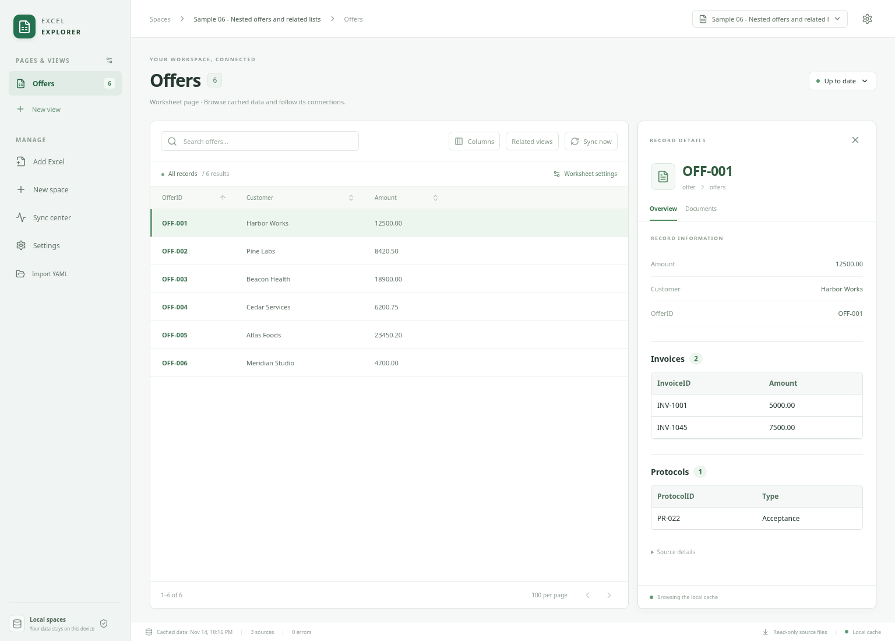

# 06 — Nested offer views with invoices and protocols

[project.xlsx](data/project.xlsx) contains **Offers**, **Invoices** and **Protocols** in one physical workbook: 6 offers, 8 invoices and 3 protocols. All data is synthetic. No macros or calculations are used.

## Configure the example in the app

1. Choose **Add Excel** and select `data/project.xlsx`. Leave the default new-space option selected.
2. Open the **Offers** page, then choose **Related views → Add related list**.
3. Choose the **Invoices** child view. Match parent **OfferID** to child **OfferID**. Keep the title Invoices.
4. Add a second list using **Protocols**, again matching **OfferID → OfferID**. Save related views.
5. Single-click **OFF-001**. The record overview shows both related lists: **INV-1001**, **INV-1045**, and **PR-022**.
6. Select **OFF-002**: only **INV-2001** appears and the Protocols list is empty. Selecting another offer never mixes its children with the previous offer.
7. Click a child row to open its details; **Back to parent record** returns to the offer. Configure a child view's own related lists to add another drill-down level.

Use **Columns** on a child page to limit its related-list columns, or create a filtered saved view first and select that as the child. The child view's filters, sort and column selection apply inside the parent record too. You can hide child pages from the sidebar and continue showing them as nested lists.

## Open the preconfigured profile

Choose **Import YAML** with [workspace.yaml](workspace.yaml), then Sync now. The optional profile predefines the two related lists, uses stable business identifiers, shows only the Offers page in the sidebar, and limits child columns for a compact display. In-app setup from the raw workbook starts with all columns visible and automatic row identities until you choose stable keys.

The profile explicitly pairs the Offers source with each child source. Records keep separate namespaces and identities; links compare configured field values only within those source pairs and the current space. Legacy YAML relationships without source pairs retain their same-namespace rule. No PDF roots/links are configured in this example; use [sample 01](../01-offers-and-finance/README.md) for document mapping.

Configuration and relationship edges persist in SQLite and work offline. Changing links rebuilds cached relationships without reading Excel. Imports of the three-sheet workbook still activate all worksheets atomically. Matching is exact and case sensitive; select compatible types and consistent trimming in Worksheet settings.

[Expected results](expected-results.json) · [Full setup guide](../../docs/SPACES_AND_PAGES.md#nested-views-offers--invoices-and-protocols) · [All samples](../README.md)
