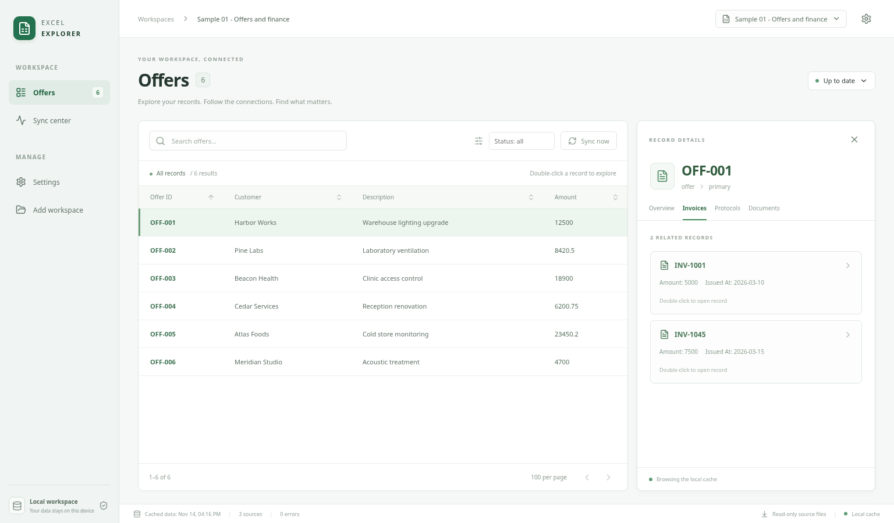
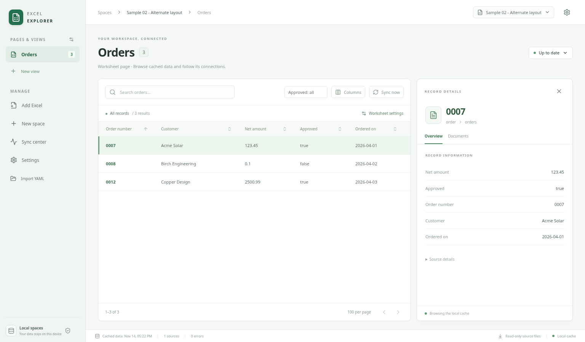
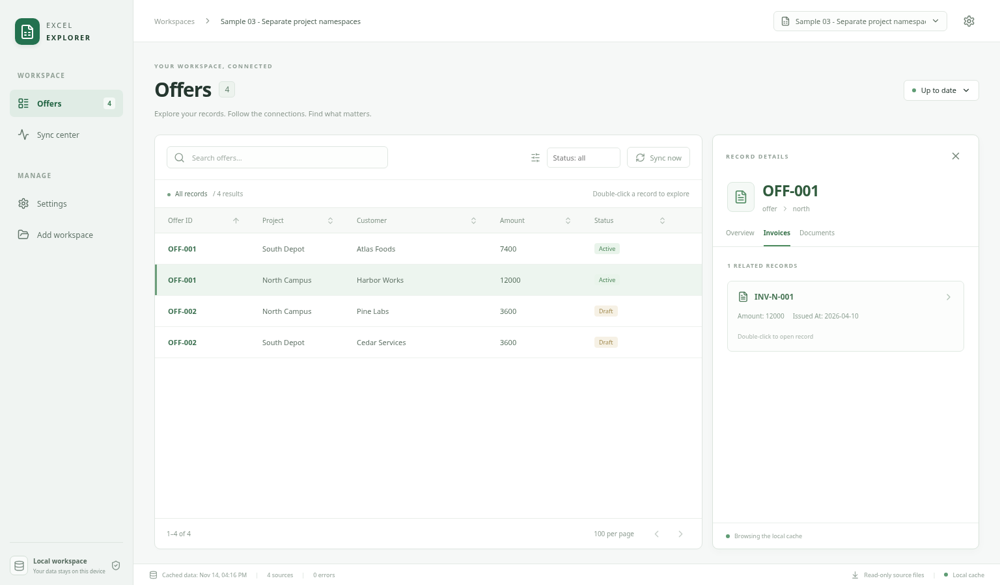
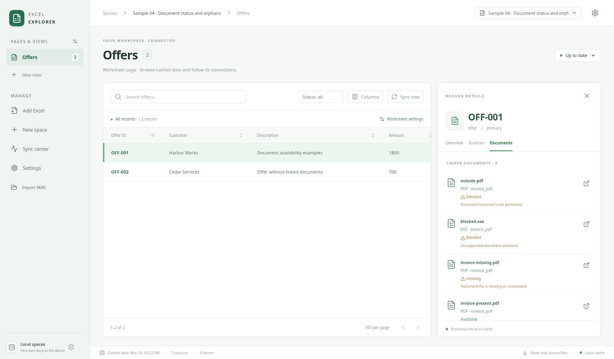
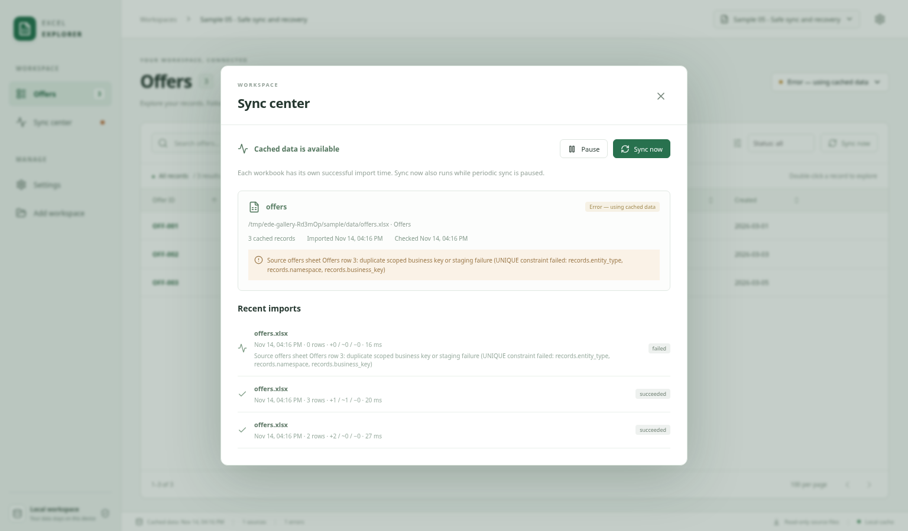
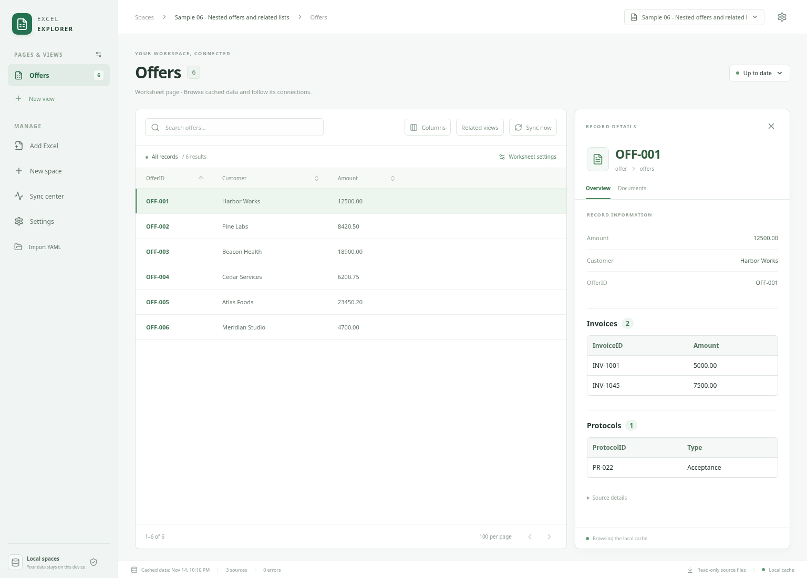

# Demo workspaces
Six ready-to-open examples with **12 Excel workbooks, 6 YAML configurations, 8 sample PDFs, 6 screenshots, and expected-result manifests**. All data is synthetic. Workbook variants for the synchronization example are included in the count.

You can also choose **Add Excel** and select any included workbook without importing YAML. That creates generic worksheet pages automatically. For the relationship/document mappings and screenshots below, use the optional YAML profile. See the [space/page guide](../docs/SPACES_AND_PAGES.md).

## Start with an example
1. Install/run the desktop application as described in the [main README](../README.md#install-and-run).
2. Choose **Import YAML**, then select an example's `workspace.yaml`.
3. Select that workspace and click **Sync now**. An example with multiple worksheets may need a few seconds for stable-file checks.
4. Double-click a table row to inspect its fields, related records and documents. Use Back or Escape to navigate.

Each example has its own workspace ID and local `data/` / `documents/` roots. You can copy an entire example folder elsewhere; keep its configuration, workbooks and documents together. It does not need a company network share or private files. Input workbooks are never modified by Explorer.

| Example | Workbooks | Expected cached records | Demonstrates |
|---|---|---|---|
| [01 — Offers and finance](01-offers-and-finance/README.md) | `offers.xlsx`, `finance.xlsx` | 6 offers, 8 invoices, 3 protocols | Multi-sheet import, relationship tabs and PDF links |
| [02 — Alternate layout](02-alternate-layout/README.md) | `orders.xlsx` | 3 orders | Different headers, reordered columns, leading-zero IDs and typed fields |
| [03 — Separate namespaces](03-namespaces/README.md) | `north.xlsx`, `south.xlsx` | 4 offers, 4 invoices | Identical offer IDs in independent projects |
| [04 — Documents and orphans](04-documents-and-orphans/README.md) | `offers.xlsx`, `invoices.xlsx` | 2 offers, 5 invoices | Missing PDF, blocked paths/extensions, unmatched parent warning |
| [05 — Sync and recovery](05-sync-recovery/README.md) | Active `offers.xlsx` plus 3 scenario workbooks | 2 → 3 → 3 cached offers on a failed update | Background reconciliation, rollback, offline browsing and recovery |
| [06 — Nested related views](06-nested-views/README.md) | `project.xlsx` with Offers / Invoices / Protocols | 6 offers, 8 invoices, 3 protocols | Configure child views in-app; single-click an offer to see both lists |

## 01 — Follow an offer to its invoices and protocol
Add [01-offers-and-finance/workspace.yaml](01-offers-and-finance/workspace.yaml). Open **OFF-001**: Invoices shows **INV-1001** and **INV-1045**; Protocols shows **PR-022**; Documents contains three available PDFs. Double-click an invoice and open its PDF in the desktop app.



## 02 — Map a different spreadsheet layout
Add [02-alternate-layout/workspace.yaml](02-alternate-layout/workspace.yaml). Excel's **OrderNumber**, **CustomerName**, **TotalNet**, **SignedOff**, and **OrderedOn** columns become application fields **code**, **customer**, **amount**, **approved**, and **ordered_at**. The actual Excel column order is different from the UI order. Open **0007**: its identifier stays `0007`, `123.4500` normalizes to the exact decimal string `123.45`, and approval becomes boolean `true`. Filter Approved by `true` or `false`.



## 03 — Keep repeated IDs in separate projects
Add [03-namespaces/workspace.yaml](03-namespaces/workspace.yaml). Both projects contain **OFF-001** and **OFF-002**. Open the **North Campus** OFF-001 row: it relates only to **INV-N-001**. Open the **South Depot** OFF-001 row: it relates only to **INV-S-001**. The namespace is part of identity and relationship scope, so neither record overwrites the other.



## 04 — See document problems without losing business records
Add [04-documents-and-orphans/workspace.yaml](04-documents-and-orphans/workspace.yaml). Open **OFF-001 → Documents**. The four links show one **available**, one **missing**, and two **blocked** documents. There is deliberately no executable in this folder: `blocked.exe` is only a string reference, rejected by extension validation. `../outside.pdf` is blocked by root/traversal validation. **INV-ORPHAN** points to nonexistent **OFF-404**, remains cached and produces one warning in Sync center. It does not appear under a fabricated offer.



## 05 — Watch a failed update preserve a valid cache
Add [05-sync-recovery/workspace.yaml](05-sync-recovery/workspace.yaml). The active input starts with **2 offers**. From the repository root, apply each named scenario and click **Sync now**:

```sh
python demo/apply_scenario.py updated
# Now 3 offers; OFF-001 has amount 15000 and OFF-003 is new.
python demo/apply_scenario.py invalid
# Duplicate OFF-001 rejects the import; the 3 valid cached offers remain.
python demo/apply_scenario.py offline
# The workbook disappears; cached browsing still works.
python demo/apply_scenario.py online
# Restores the same invalid workbook; the error remains until the source is fixed.
python demo/apply_scenario.py baseline
# Successful recovery to the original 2-offer input.
```

This helper intentionally changes **only the synthetic example input**. The application continues to treat all sources as read-only. The helper refuses to overwrite an offline backup. The screenshot shows the failed import **after** the successful three-offer update, rather than the two-offer initial state shipped in `data/offers.xlsx`.



## 06 — Configure nested views in the app
Add [06-nested-views/data/project.xlsx](06-nested-views/data/project.xlsx) without YAML, choose **Offers → Related views**, and match **OfferID → OfferID** for the Invoices and Protocols child views. Selecting an offer shows both lists. Or import [the ready-made profile](06-nested-views/workspace.yaml), which hides child sidebar pages and uses compact child columns. [Complete walkthrough](06-nested-views/README.md).



## Regenerate, validate and capture images
Run these commands from the repository root:

```sh
npm run demo:samples
# Or regenerate both the original larger fixture and these six examples:
npm run demo

npm run test:core
python -m unittest discover -s demo -p "test_*.py"
npm run core:build
npx playwright install chromium
npm run test:e2e

# Regenerate the six preview.png files from real app/SQLite data:
npm run demo:images
```

Regeneration resets the synthetic active workbooks and the sync sample's offline toggle. It leaves authored YAML profiles, Markdown guides and existing screenshots intact; `demo:images` refreshes screenshots separately. Use `CHROMIUM_PATH` if using an existing Chromium installation. No Python packages beyond the standard library are needed.

Every `expected-results.json` is checked against the actual Rust import/query path. Tests copy samples to temporary folders, proving relative-path portability and keeping the shipped workbooks unchanged. The UI tests also verify both namespace drill-downs, document validation and failed-import recovery.

Screenshots are captured from the React UI with the real Rust/SQLite backend through a **test-only IPC bridge**. Native Windows window chrome/events are stubbed in those tests. These are actual sample records and errors, not concept mockups; native Windows sign-in/tray/default-viewer behavior remains covered by the separate [Windows verification instructions](../docs/WINDOWS_RELEASE.md).
