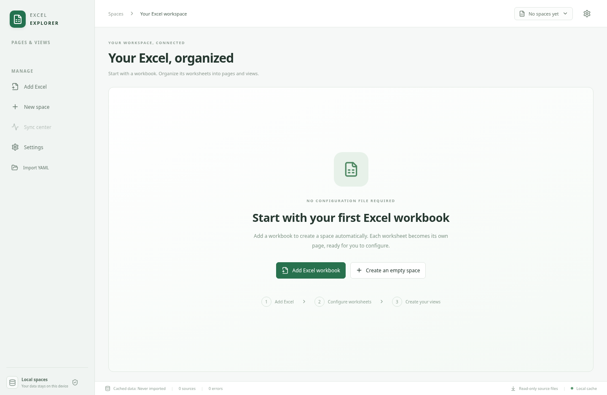
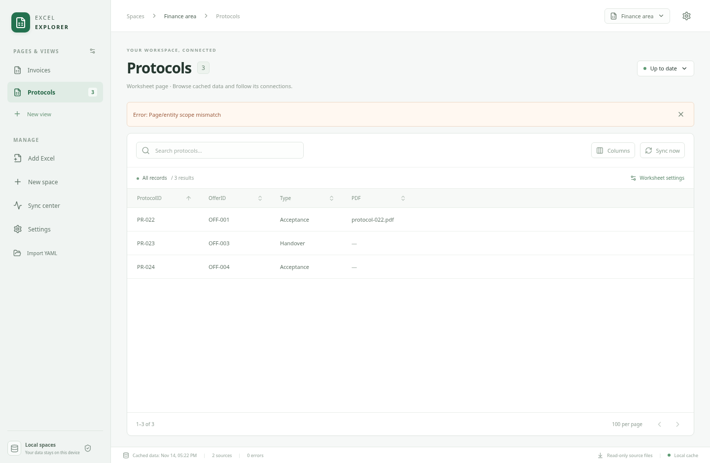
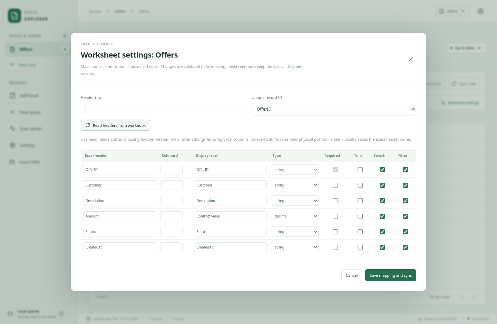
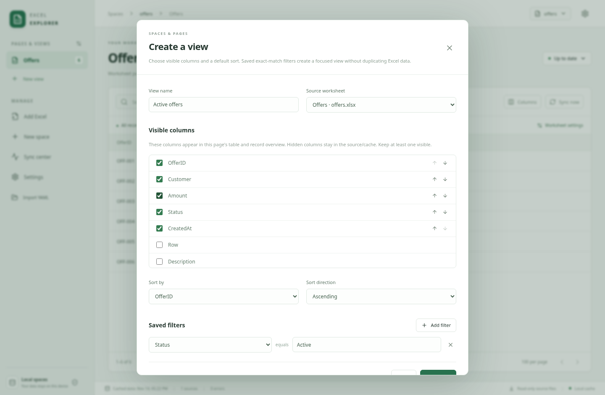
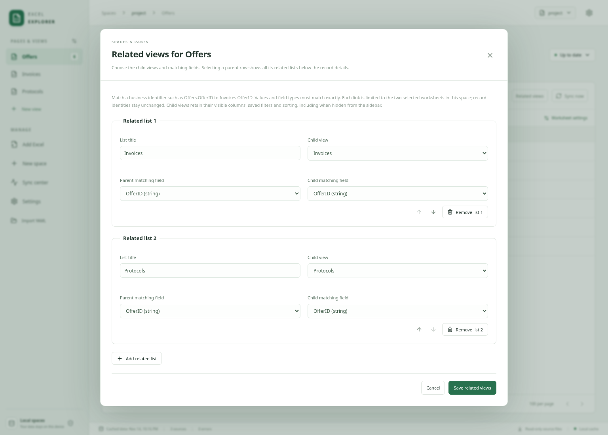

# Spaces, worksheet pages and saved views

The app now starts with an empty, usable home screen. No YAML file, demo profile or existing workspace is required. Existing caches and YAML-imported workspaces are preserved when upgrading.

## Start without configuration

1. Launch the desktop app normally.
2. Click **Add Excel workbook**, or choose **New space** to name an empty area first.
3. Select one or more `.xlsx`, `.xls`, `.xlsm`, `.xlsb` or `.ods` files.
4. The preview shows worksheet names, headers, a bounded sample and populated row counts. Verify the proposed header rows before configuring more specialized layouts.
5. Leave **New space for each workbook (default)** selected, or choose an existing space to group files.
6. Click **Add workbooks**. Every worksheet gets a page, including an empty worksheet. The native desktop queues background synchronization; cached browsing stays separate from Excel reading.

The first populated row is treated as the header by default. All fields initially preserve source values as text, rather than guessing IDs, currency or locale-specific dates. Header names that are unique bind by name so they follow columns when Excel reorders them. Blank and duplicate headers use explicit physical column positions. Formulas/macros are never calculated or executed.

In the preview, a worksheet checkbox controls whether its page appears in navigation. Hiding a page does not stop its ingestion or delete cached data. You can show it again in Pages and views.

## Spaces and pages

Use the **Space** picker to switch areas. A workbook creates a separate space by default; importing two workbooks together therefore creates two spaces unless you select an existing area. **New space** creates an empty named area, and the import target selector adds files to it. Page names come from worksheet names. Grouped workbooks with overlapping sheet names receive disambiguated page titles; names can be edited later.

The sidebar lists worksheet pages and saved views. Each page queries its configured entity and source through SQLite, with bounded pagination. Pages from one physical workbook share a snapshot and atomic activation. Hidden pages keep their source/cache intact; views can still be created from those worksheets.

Open **Manage pages and views** beside the sidebar heading to rename the space, hide/show pages, edit page columns, create a view, or choose a worksheet mapping. It remains available if every page is hidden.

## Configure a worksheet

Choose **Worksheet settings** above a page, or select a source under **Pages and views → Worksheet mappings**.

- **Header row** is the one-based Excel header row. Change it for sheets with title/banner rows, then use **Read headers from workbook**.
- **Unique record ID** can use a chosen column or the automatic row-number fallback. A selected key is a required string; leading zeros in Excel Text cells are preserved.
- **Excel header** is the mapped source header. A blank **Column #** binds by exact header name; an explicit one-based number binds by physical position.
- **Display label** changes the user-facing column title without renaming the cached field identity.
- **Type** supports string, integer, decimal, boolean, date and datetime. Required/trim/search/filter controls are available per field.
- **Read headers** refreshes mappings while preserving matched logical fields, custom labels and types. New duplicate/blank headers get distinct positional mappings; a disappeared selected key falls back explicitly to row numbers.
- **Save mapping and sync** validates the configuration, saves it and requests background reimport. Invalid required values or duplicate chosen keys fail the workbook import and preserve its previous valid records.

The default row-number key supports spreadsheets without a unique ID and permits duplicate business values. It identifies worksheet positions, so row moves/reordering can change which business record occupies an internal identity. Select a real unique ID column for stable identity across reordering. No uniqueness or business relationship is guessed from a preview.

An initially empty worksheet has no mapped business columns. When you add data/columns, use Read headers and configure the visible columns. Sheets with no usable mapped columns report an import error rather than silently replacing a populated cache.

## Create and customize views

Choose **New view** in the sidebar. Pick a worksheet, give the view a name, choose/reorder visible columns, set a default sort, and optionally add exact-match filters. A view reuses the same cached records; it does not copy Excel data or create another import source.

For example, create **Active offers** from Offers with **Status equals Active**, then hide Description. The saved filter is applied by the backend and cannot be overridden by a transient query. Sort/search/live filters still operate on the allowed visible fields.

The **Columns** button edits the current page or view. At least one column remains visible, and the sort column must be visible. Hidden columns disappear from that page's table, overview and search; source values remain cached. Saved views, page visibility, column order, filters, active space/page and per-page table state persist across restarts.

Visibility controls are personal display preferences, **not access permissions or data deletion**. This app still has one local user. Raw cached records, other views, related records and advanced YAML commands may expose the same data. No multi-user roles or row/column security system is introduced.

## Nested views: Offers → Invoices and Protocols

Place the three worksheets in the same space (one workbook does this automatically). From the Offers page or a saved Offers view, click **Related views**. Add an Invoices child list with parent **OfferID** and child **OfferID**, then add a Protocols list with the same matching fields. Give each list a title and save. No YAML or reimport is needed to build links from cached data.

Single-click or keyboard-select an offer. Its overview shows both child lists together, including counts and an explicit empty state. Each list requests bounded 25-row pages from SQLite; large lists have independent paging. Click a child row or use Enter/Space to open its details. **Back to parent record** returns to the previous level. Configure related lists on that child view to continue nesting.

Child views retain visible columns, sorting and authoritative saved filters. The join field can be hidden from the child table. A page hidden from sidebar navigation can still be selected as a related child view. Each parent page/view owns its ordered list of links; another saved view over Offers can use different child lists. Reorder or remove links in the editor. Removing a list keeps source records and other pages' links.

Choose a real business identifier, not the automatic Row field. Joins compare exact normalized values, with matching types and consistent trimming. Empty keys do not manufacture parent rows. Nonunique parent fields can match children to multiple parent records; choose an offer's unique identifier for ordinary one-to-many relationships.

Links explicitly pair two source definitions inside one space. They can connect the separately namespaced worksheets created by Add Excel without changing their namespaces or record IDs. The engine validates both source IDs and both field types, scopes all edges to that pair and workspace, and keeps the default same-namespace rule for legacy unscoped YAML relationships. Cross-space links are rejected.

Try [sample 06](../demo/06-nested-views/README.md) for a three-sheet workbook, optional ready-made configuration and screenshot. Legacy main pages combining multiple sources retain their YAML relationship tabs; create a worksheet-specific saved view to configure the new nested lists.

## Persistence, offline behavior and advanced YAML

App-created spaces/configuration live in SQLite under the normal local user data directory. There is no external configuration file to maintain. Page/column visibility, view creation and space renaming work from cache without Excel. Presentation edits do not invalidate source fingerprints or force reimport. Mapping/key/type changes request reimport; failures preserve the last successful dataset.

Workbook paths remain references to the files you selected; the app does not edit, move or duplicate them as user data. Keep workbooks at those paths. Copies made for parsing are private temporary snapshots.

**Import YAML** remains available for existing workspaces, explicit relationships, document mappings and other advanced configuration. Those profiles retain their original main/detail behavior and appear as spaces with an initial main page. Editing them through the GUI creates an app-managed persisted profile and leaves the original YAML file unchanged. Explicitly importing the original YAML again replaces the active profile for its workspace ID, including its page definitions. YAML remains optional for spaces, worksheet mappings and nested view relationships. Document mappings/allowed roots still use advanced YAML. Relationships and document roots are not inferred automatically from arbitrary column names.

## Verification and screenshots

Rust tests cover empty startup and persistence, all-sheet import (including empty/duplicate-header sheets), separate/grouped spaces, source-scoped page queries, stable name-based mapping after column reordering, typed mapping/key failures, saved filtered views, offline restart, hidden-page/column settings and legacy YAML compatibility.

Playwright tests drive the same flows through the React UI against the real Rust engine. The screenshots above use that test-only IPC bridge; native Windows chrome/events are stubbed. Native file picker/tray/sign-in/installer behavior still requires Windows integration verification. Run the full browser suite with `npm run test:e2e`, or regenerate the sample and onboarding images with `npm run demo:images`.
